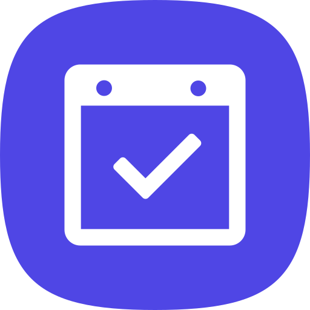
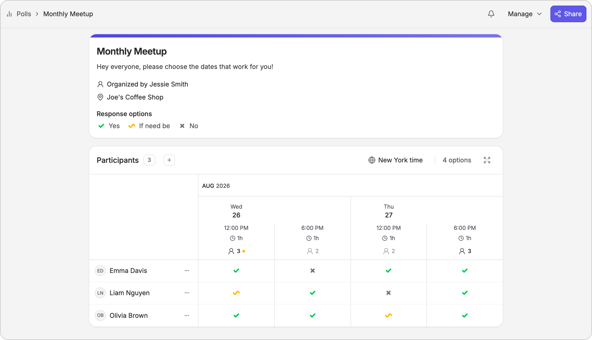

# Rallly

**Schedule group meetings, without the back-and-forth**

[**Website**](https://rallly.co) · [**Documentation**](https://support.rallly.co) · [**Discord**](https://discord.gg/uzg4ZcHbuM)

<b>Original Rallly README (click to expand)</b>

Rallly is an open-source scheduling tool that helps you find the best date and time to meet. Create a poll with a few options, share the link, and let your participants vote on when they're available. No more back-and-forth emails.

## ✨ Features

- 📅 **Date & time polls** — Propose multiple options and find what works for everyone
- 🗳️ **No account needed to vote** — Participants just open the link and respond
- 📊 **Availability grid** — See everyone's responses at a glance
- 💬 **Comments** — Discuss the details right on the poll
- 🔔 **Notifications** — Get notified when participants respond
- ✅ **Finalize a date** — Pick the winning option and notify everyone
- 🌍 **10+ languages** — Community-translated via [Crowdin](https://crowdin.com/project/rallly)
- 🔒 **Open source & self-hostable** — Own your data

## ☁️ Cloud version

The quickest way to get started is the hosted version. Create your first poll in seconds, no installation required.

**[Try Rallly free →](https://rallly.co)**

## 🐳 Self-hosting

Prefer to run your own instance? Rallly ships as a Docker image and can be self-hosted in minutes.

See the [self-hosting docs](https://support.rallly.co/self-hosting) for installation and [configuration options](https://support.rallly.co/self-hosting/configuration-options).

## 🛠️ Built with

[Next.js](https://github.com/vercel/next.js/) · [Prisma](https://github.com/prisma/prisma) · [tRPC](https://github.com/trpc/trpc) · [TailwindCSS](https://github.com/tailwindlabs/tailwindcss)

## 🤝 Contributing

Contributions are welcome! Have a look at the [contributing guide](CONTRIBUTING.md) to get started with local development and find out how you can help.

- 🌐 **Translators** — Help [translate Rallly](https://support.rallly.co/contribute/translations) into your language
- 🔐 **Security** — Found a vulnerability? See our [security policy](SECURITY.md)
- 🤝 **Community** — Please read our [Code of Conduct](CODE_OF_CONDUCT.md)

## 📜 License

Rallly is open-source under the GNU Affero General Public License Version 3 (AGPLv3) or any later version. See [LICENSE](LICENSE) for more detail.

## 💚 Sponsors

Thank you to our sponsors for making this project possible.

[Become a sponsor &rarr;](https://github.com/sponsors/lukevella)

 

---

## 🇰🇷 Kor

> 본 프로젝트는 wonderwall1995 개인의 **QA 엔지니어 포트폴리오** 및 학습 목적으로 만든 웹 데모입니다.
>
> - 원본은 [lukevella/rallly](https://github.com/lukevella/rallly)이며, 모든 저작권은 원저작자 Luke Vella와 Rallly 기여자들에게 있습니다.
> - 본 프로젝트는 **상업적 목적이 없습니다.** 수익을 얻지 않으며 유료 서비스로 제공하지 않습니다.
> - 원본의 라이선스 (GNU AGPL v3 이상)를 준수합니다. 저작권 및 라이선스 고지를 유지하고, 변경한 내용은 명시하며, 수정본도 동일한 라이선스로 소스 코드를 공개합니다.
> - 본 프로젝트는 원저작자와 **무관한 비공식 프로젝트**이며, 원저작자의 보증이나 후원을 받지 않았습니다.
> - Rallly의 이름과 로고에 대한 권리는 원저작자에게 있습니다. 문제가 있다면 알려 주시면 즉시 조치하겠습니다.
> - 이 저장소의 목적은 테스트 설계, 자동화 테스트, 버그 리포트 등 QA 역량을 보여 주는 것입니다.

## 🇺🇸 Eng

> This project is a web demo created by wonderwall1995 for personal **QA engineer portfolio** and learning purposes.
>
> - The original project is [lukevella/rallly](https://github.com/lukevella/rallly). All copyrights belong to the original author, Luke Vella, and the Rallly contributors.
> - This project has **no commercial purpose.** It earns no revenue and is not offered as a paid service.
> - It complies with the original license (GNU AGPL v3 or later). Copyright and license notices are kept, changes are stated, and the modified source code is published under the same license.
> - This is an **unofficial project, not affiliated with** the original author, and it is not endorsed or sponsored by them.
> - Rights to the Rallly name and logo belong to the original author. If there is any concern, please let me know and I will act promptly.
> - The purpose of this repository is to demonstrate QA skills such as test design, test automation, and bug reporting.
